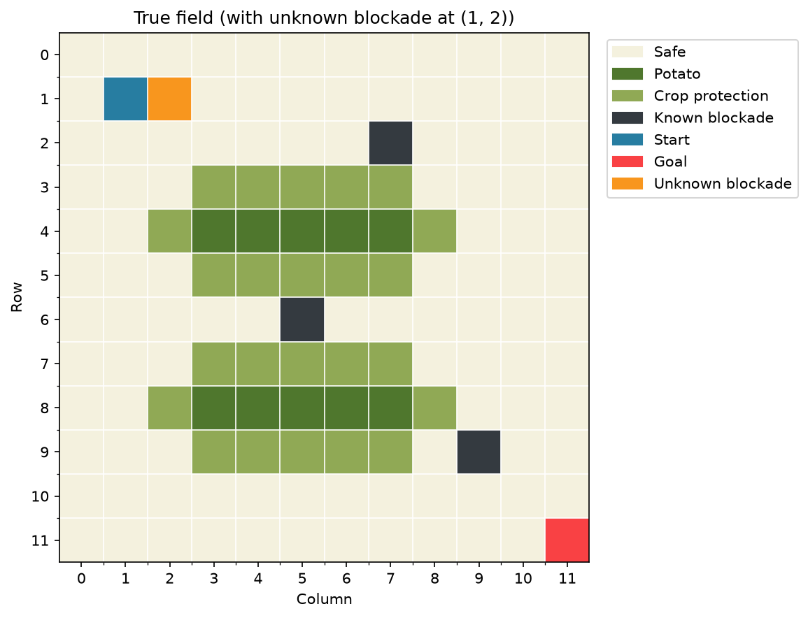
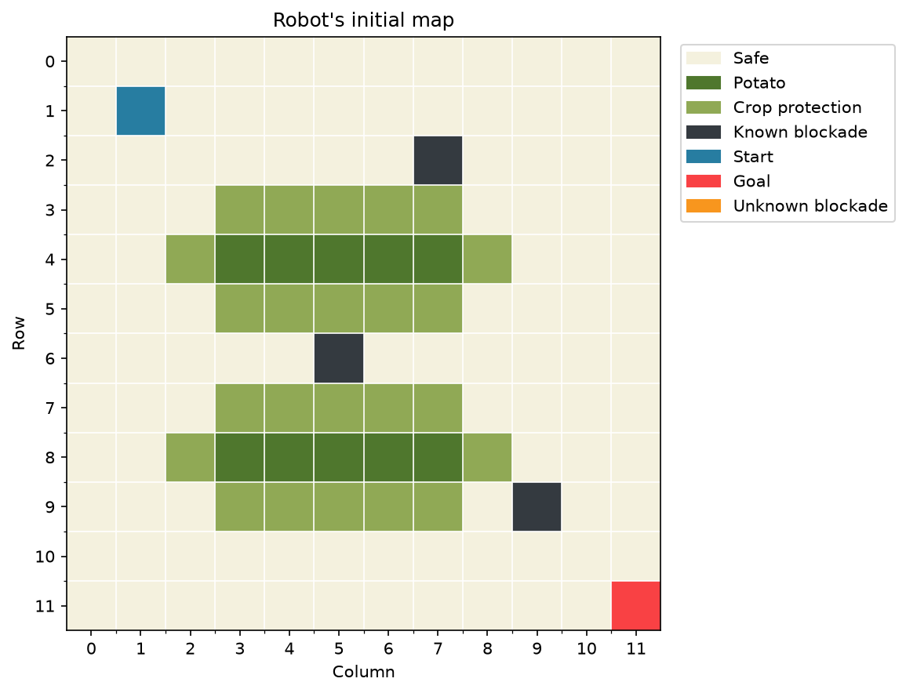
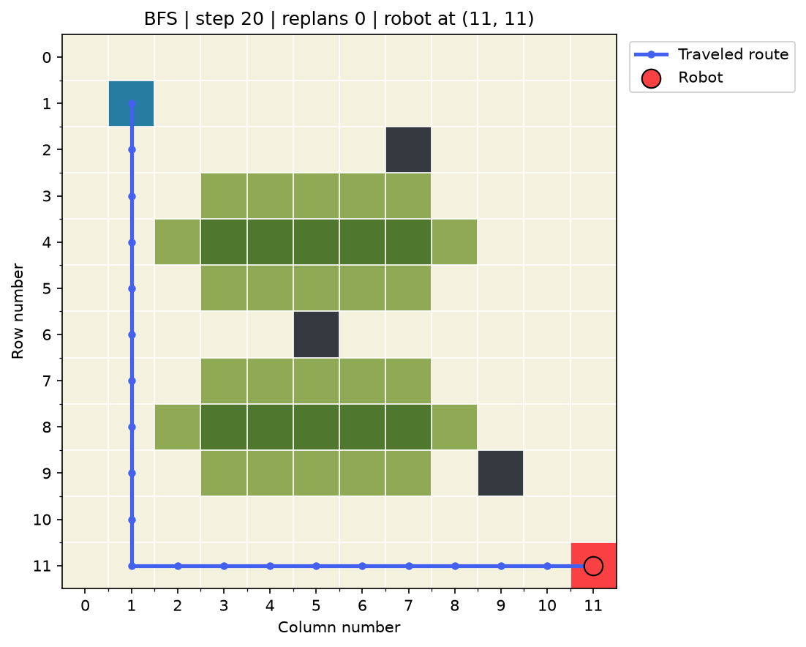
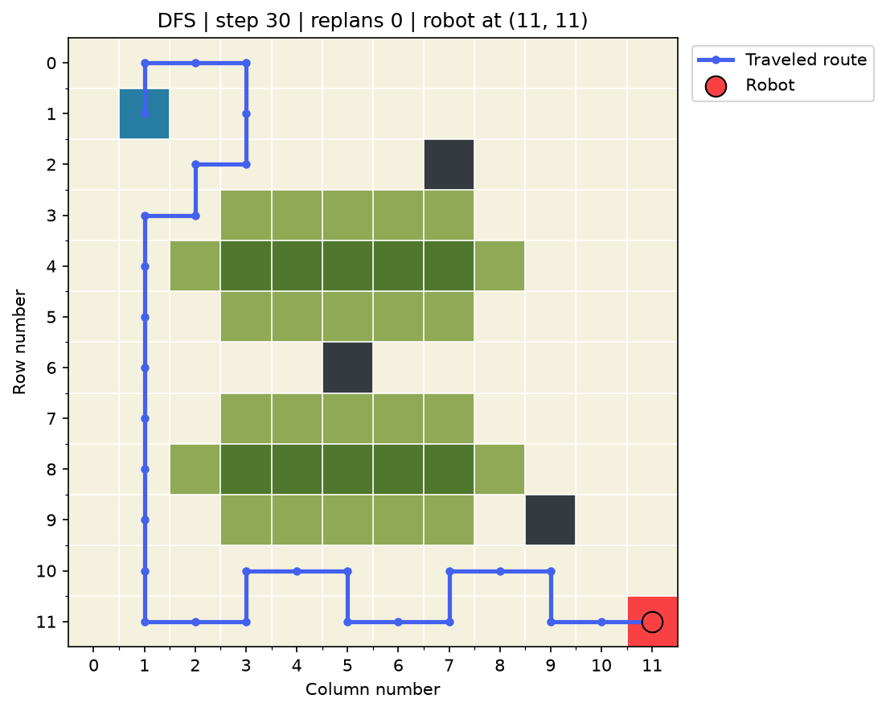
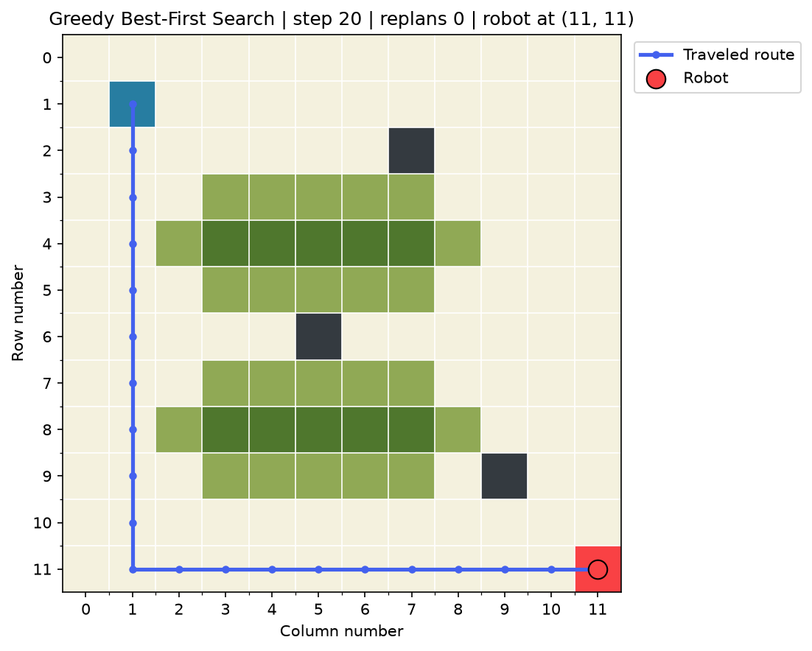
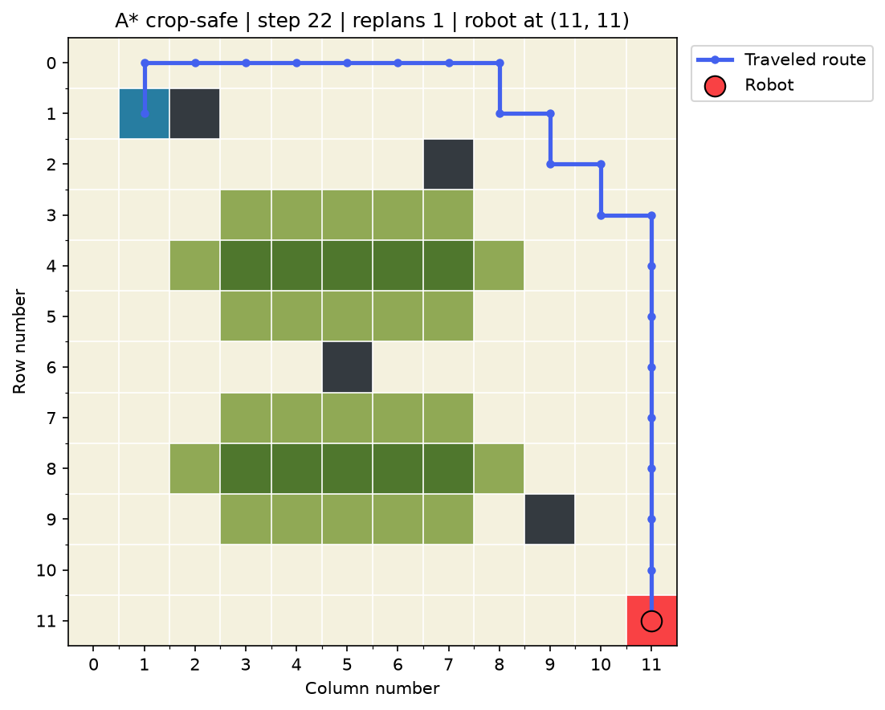

# AI-Based Crop-Safe Path Planning for an Autonomous Potato-Field Robot — Group 08

An autonomous robot used for potato-field monitoring must travel between crop rows, visit selected monitoring locations, and avoid damaging plants. This project models the potato field as a two-dimensional grid and applies AI search techniques (**BFS**, **DFS**, **Greedy Best-First Search**, and **A\* Crop-Safe Search**) to plan a route from a start cell to a destination, including online detection and replanning when an initially unknown obstacle is encountered.

## Project Files

- [`CropSafe_PathPlanning.ipynb`](CropSafe_PathPlanning.ipynb) — Interactive Jupyter notebook for 2D field setup, grid visualisation, problem formulation, search algorithms, animated route simulations, and A\* crop-safe reporting.
- [`performance_evaluation.py`](performance_evaluation.py) — Standalone verification and benchmarking script that checks path-safety constraints and measures path length, expanded nodes, execution time, goal reachability, and replanning operations across baseline and online-obstacle scenarios.
- [`problem_formulation.md`](problem_formulation.md) — Formal specification of the state space, actions, transition model, goal test, path-cost function, and online obstacle-discovery rules.
- [`DOCUMENTATION.md`](DOCUMENTATION.md) — Detailed technical documentation covering Tasks 1–6, testing methodology, and performance analysis.

## Algorithms and Heuristic

All algorithms operate on a 4-connected grid (`Up`, `Down`, `Left`, `Right`; no diagonal moves). Potato cells (`P`), crop-protection cells (`R`, one Manhattan step from any potato cell), and blockades (`X` / `?`) are impassable.

- **Breadth-First Search (BFS):** Explores the grid level by level using a FIFO queue. Guarantees the minimum number of moves when every legal step has unit cost.
- **Depth-First Search (DFS):** Explores one branch deeply using a LIFO stack before backtracking. Memory-light, but typically produces longer, non-optimal paths depending on action ordering.
- **Greedy Best-First Search (GBFS):** An informed search that expands the node with the lowest heuristic estimate `h(n)` using a priority queue. Fast and expands very few nodes, though it does not account for accumulated path cost `g(n)`.
- **A\* Crop-Safe Search:** Minimizes `f(n) = g(n) + h(n)` where `g(n)` is the accumulated crop-safe movement cost and `h(n)` is the heuristic. In addition to treating potato and protection cells as impassable, it applies graduated proximity penalties to safe cells near crops (`CROP_SAFETY_PENALTIES = {2: 6, 3: 2}` for Manhattan clearances of 2 and 3 steps from a crop), preferring routes with wider crop clearance when available.

### Heuristic Function

Both **GBFS** and **A\*** use **Manhattan Distance** from the current cell `(r, c)` to the destination `(r_g, c_g)`:

```text
h(n) = |r - r_g| + |c - c_g|
```

Because the robot can only move orthogonally (one unit per step) and every legal move costs at least `1`, Manhattan distance never overestimates the remaining cost to the goal, making it **admissible** (and consistent) for A\*.

## Required Libraries and How to Run

### Prerequisites

- Python 3.9+
- `matplotlib`
- `jupyter` / `ipython` (for running the interactive notebook)

Install the required packages:

```bash
python -m pip install jupyter matplotlib
```

### Running the Interactive Notebook

1. Open `CropSafe_PathPlanning.ipynb` in Jupyter Notebook or VS Code.
2. Run the cells sequentially from top to bottom.
3. When prompted, enter grid dimensions and coordinates in `(row,column)` format with `(0,0)` at the top-left (for multiple cells, separate with semicolons, e.g. `2,7; 6,5; 9,9`).
4. Use the same field configuration across all four solvers to compare their routes and animations.

### Running the Performance Evaluation & Safety Tests

To reproduce the Task 6 metrics (path length, expanded nodes, execution time without animation delay, replanning count, and crop-safety assertions) directly from the terminal:

```bash
python performance_evaluation.py
```

## Demonstration Field Configuration

The saved screenshots and benchmark tables use the following 12×12 field:

| Parameter | Value |
|---|---|
| Grid size | 12 × 12 |
| Start cell | `(1, 1)` |
| Destination cell | `(11, 11)` |
| Potato crop rows | Row 4, columns 3–7; Row 8, columns 3–7 |
| Crop-protection zone | Automatically placed 1 Manhattan step from every crop cell |
| Known blockades | `(2, 7)`, `(6, 5)`, `(9, 9)` |

## Screenshots of Program Output

Generated from the 12×12 field with known blockades at `(2, 7)`, `(6, 5)`, `(9, 9)` and an initially unknown blockade at `(1, 2)` (Experiment B) to demonstrate both crop-safe routing and A\* online replanning.

### True Field and Robot's Initial Map

| True Field (with unknown blockade at `(1, 2)`) | Robot's Initial Map (unknown blockade hidden) |
|---|---|
|  |  |

### Route Visualisations

| BFS (20 moves, 0 replans) | DFS (30 moves, 0 replans) |
|---|---|
|  |  |

| Greedy Best-First Search (20 moves, 0 replans) | A\* Crop-Safe Search (22 moves, 1 replan) |
|---|---|
|  |  |

## Performance Comparison (Task 6)

All metrics below were verified using `performance_evaluation.py` (averaged over 50 runs for search execution time, excluding Matplotlib animation delays).

### 1. Baseline Field (No Unknown Blockades)

| Algorithm | Path length (moves) | Expanded nodes | Execution time (ms) | Destination reached? | Replanning operations | A\* crop-safe path cost | Min crop clearance |
|---|---:|---:|---:|---|---:|---:|---:|
| BFS | 20 | 107 | 0.439 | Yes | 0 | N/A | 2 steps |
| DFS | 30 | 34 | 0.136 | Yes | 0 | N/A | 2 steps |
| Greedy Best-First Search | 20 | 21 | 0.049 | Yes | 0 | N/A | 2 steps |
| A\* crop-safe | 22 | 37 | 0.300 | Yes | 0 | 22 | 4 steps |

### 2. Online-Obstacle Experiments (Unknown Blockade Detection & Replanning)

**Experiment A — Unknown blockade at `(0, 1)` (matches the latest notebook execution):**

| Algorithm | Path length (moves) | Expanded nodes | Execution time (ms) | Destination reached? | Replanning operations | A\* crop-safe path cost | Min crop clearance |
|---|---:|---:|---:|---|---:|---:|---:|
| BFS | 20 | 107 | 0.408 | Yes | 0 | N/A | 2 steps |
| DFS | 24 | 61 | 0.252 | Yes | 1 | N/A | 2 steps |
| Greedy Best-First Search | 20 | 21 | 0.046 | Yes | 0 | N/A | 2 steps |
| A\* crop-safe | 22 | 37 | 0.273 | Yes | 0 | 22 | 4 steps |

**Experiment B — Unknown blockade at `(1, 2)` (demonstrating A\* online replanning):**

| Algorithm | Path length (moves) | Expanded nodes | Execution time (ms) | Destination reached? | Replanning operations | A\* crop-safe path cost | Min crop clearance |
|---|---:|---:|---:|---|---:|---:|---:|
| BFS | 20 | 107 | 0.447 | Yes | 0 | N/A | 2 steps |
| DFS | 30 | 34 | 0.142 | Yes | 0 | N/A | 2 steps |
| Greedy Best-First Search | 20 | 21 | 0.048 | Yes | 0 | N/A | 2 steps |
| A\* crop-safe | 22 | 72 | 0.486 | Yes | 1 | 22 | 4 steps |

### Summary of Observations

- **Goal Reachability & Safety:** All four algorithms reached `(11, 11)` across every scenario without entering any potato, crop-protection, or blockade cell.
- **Optimality vs. Node Expansion:** On this grid, BFS and GBFS both found a shortest-move path of 20 moves, but GBFS expanded ~81% fewer nodes (21 vs. 107) and ran ~8–9× faster because Manhattan distance directly guides it toward `(11, 11)`. DFS took 30 moves on the baseline grid due to its fixed action-popping order.
- **Crop-Safe Trade-off in A\*:** BFS, DFS, and GBFS all travel down column 1, passing within 2 Manhattan steps of the potato rows (`min_clearance = 2`). A\* deliberately takes 2 extra moves (22 moves total) to detour above row 3 and down column 11, maintaining at least **4 Manhattan steps** of crop clearance and achieving **0 penalized near-crop steps** (crop-safe cost = 22).
- **Online Replanning:** With an unknown blockade at `(0, 1)`, DFS detects it on its first upward step, marks `(0, 1)` as blocked, and replans to reach the goal in 24 moves. With an unknown blockade at `(1, 2)`—the first step of A\*'s preferred detour—A\* detects the obstacle, updates its map, and replans a 22-move crop-safe route (72 total node expansions across both plans).

## Group Members and Contributions

| Member | Name | Roll Number | Contribution |
|---|---|---|---|
| 1 | Nerella Leela Venkata Sai | BT24CSA008 | Field environment design and problem formulation |
| 2 | Parthasaradhi Guda | BT24CSA061 | BFS and DFS implementation |
| 3 | Rishishwar Reddy | BT24CSA058 | Greedy Best-First Search and heuristic design |
| 4 | Mouryagna Baindla | BT24CSA015 | A\* implementation and crop-safe path cost |
| 5 | K Shashank Reddy | BT24CSA014 | Obstacle detection simulation, map update, and replanning |
| 6 | Dineswara Kumar | BT24CSA062 | Testing, visualisation, performance comparison, and documentation |
